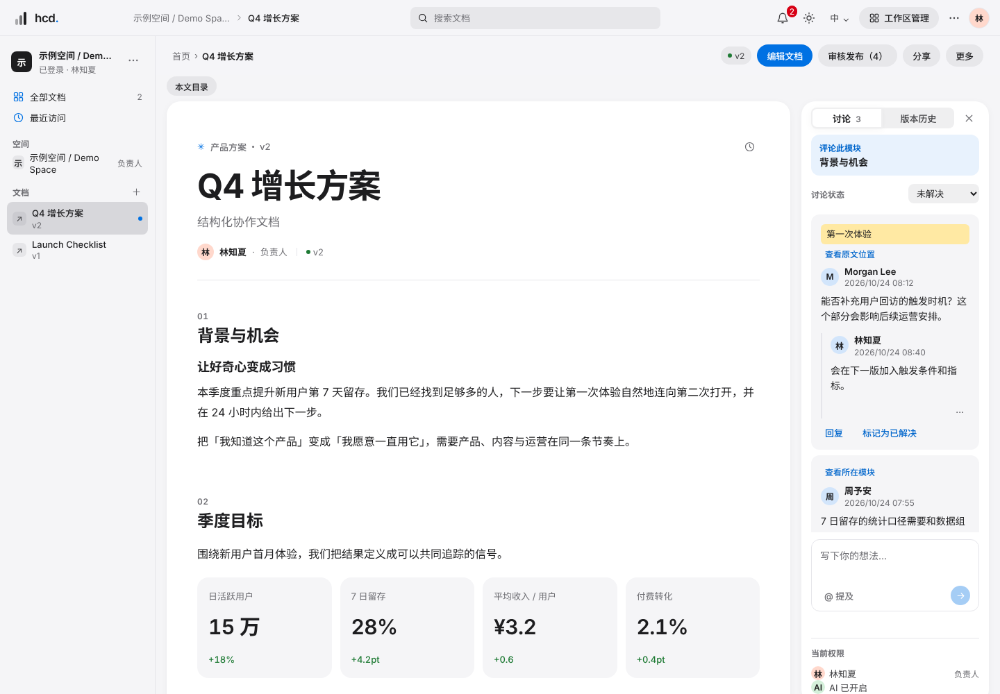
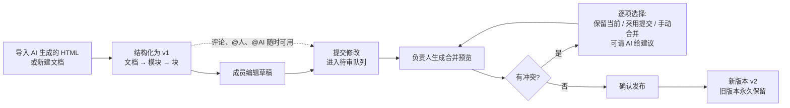
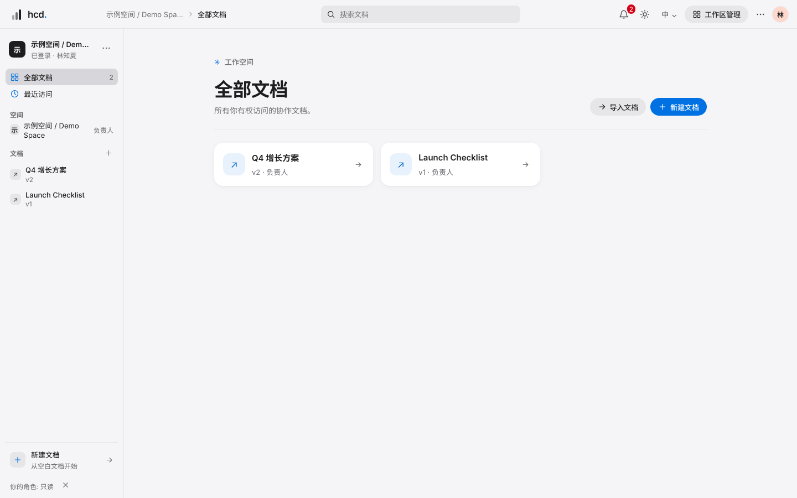
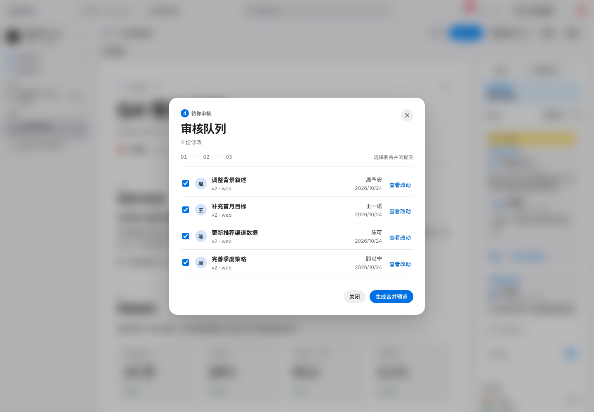
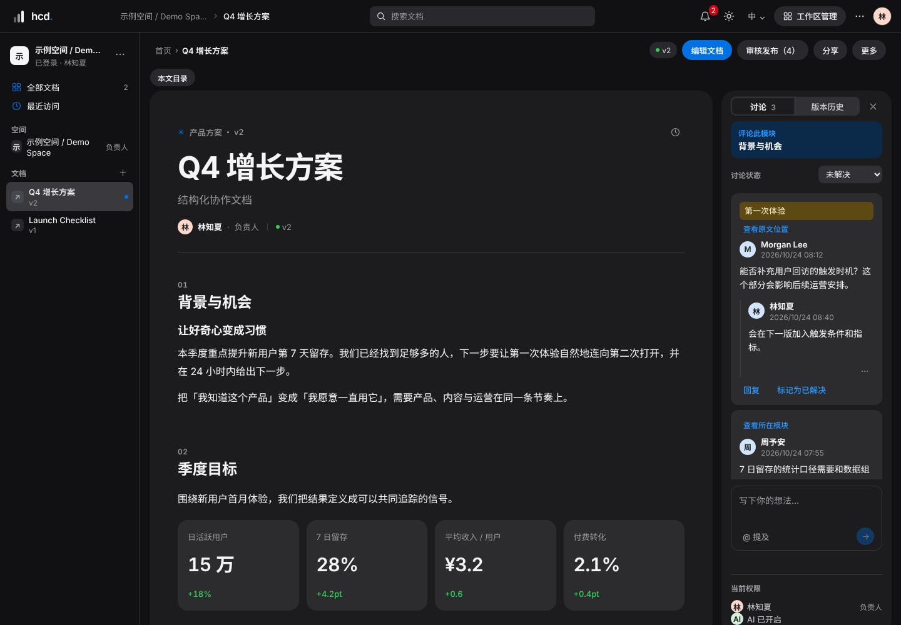
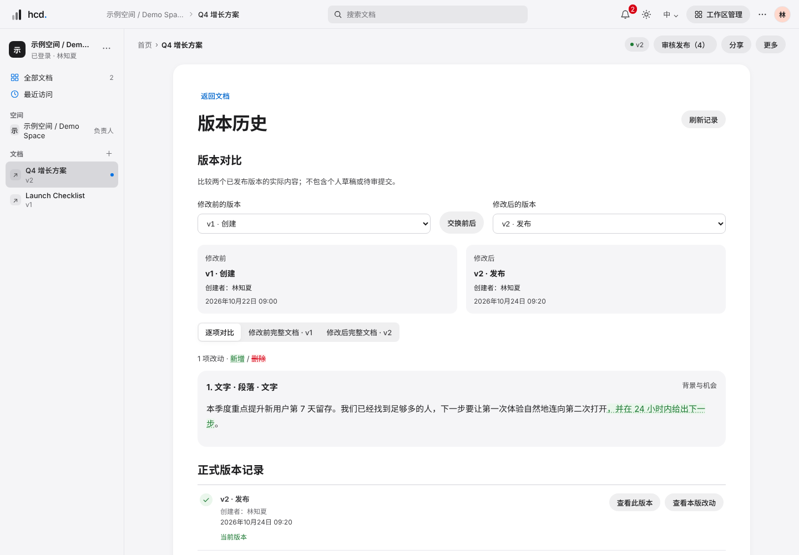
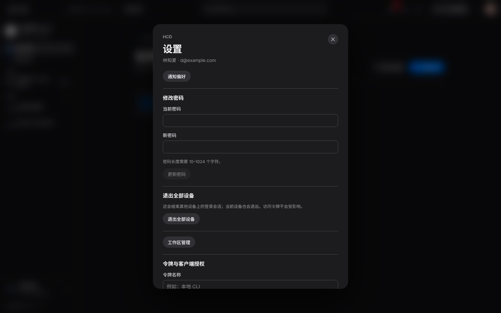
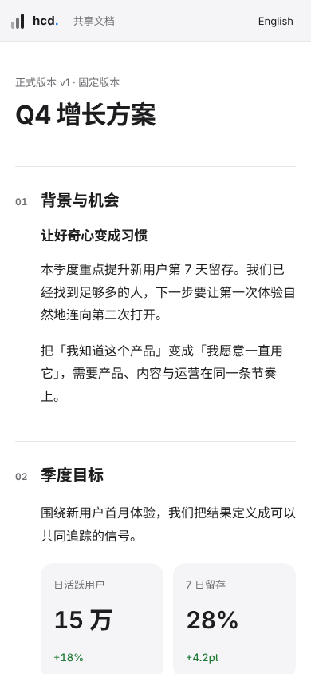

# HCD 产品说明

**HCD（HTML Collab Docs，HTML 协作文档）** 是一个开源、可自部署的协作文档系统，专门解决一个新问题：**AI 能一次生成很漂亮的 HTML 方案和报告，但团队没法在上面多人修改、评论、审核和留痕。**

HCD 把这类文档变成结构化内容，让团队成员和 AI（Claude、Codex 等）都以“提交修改”的方式参与，由负责人审核后发布成不可变的版本。

> 本项目由 **Claude**（Anthropic）与 **Codex**（OpenAI）两个 AI 在项目负责人 **Alkaid** 的指导下共同完成：Codex 实现产品和测试，Claude 负责独立审查、修复规格、前端视觉改版和发布前修复。详见 [AUTHORS.md](../AUTHORS.md)。
>
> 当前版本 `0.1.0` 是**开发测试版**：适合本地运行、评审和继续开发，还不是可直接对外服务的生产版本（见第 11 节）。



---

## 1. 它适合谁

| 场景 | HCD 怎么帮上忙 |
| --- | --- |
| 用 AI 写方案、周报、复盘，但团队要一起改 | 导入 AI 生成的 HTML，拆成模块；每个人改自己的部分，互不覆盖 |
| 改动必须有人把关再生效 | 所有修改先是“提交”，负责人合并预览、处理冲突后才发布新版本 |
| 想让 AI 当协作者，又不放心它直接改正式文档 | AI 通过 MCP 或命令行 `mdoc` 提交修改，和人走同一条审核流程，永远不能自己发布 |
| 要给客户或外部同事看、收反馈 | 分享链接（可固定在某个版本，可设有效期），访客验证邮箱后评论 |
| 要留痕、可回溯 | 每个版本永久保留，可两两对比、可恢复 |

**不做的事**：多人同时在一处实时输入（已为将来接入 Yjs 预留约束）、任意 HTML 的无损编辑、服务器主动调用 AI 模型（AI 一律由外部通过 MCP / CLI 接入）、手机上编辑（手机上可阅读、评论和查看审核）。

---

## 2. 核心流程



七条设计原则决定了它的行为：

1. **正式版本只能通过发布事务改变**——任何人和 AI 的修改都先是提交。
2. **确定的事交给程序，有歧义的由人决定，AI 只给建议。**
3. 内容是结构化数据，HTML 只是展示与交换格式。
4. 同样的输入，合并结果必须完全一样。
5. **宁可报冲突，不可静默覆盖。**
6. 简单优先：单机、单进程、SQLite。
7. 导入时尽量识别外部 HTML；识别不了的部分原样保留、只读、可评论，原文件永远保留。

---

## 3. 角色与权限

| 能力 | 负责人 owner | 编辑者 editor | 评论者 commenter | 只读 viewer |
| --- | :-: | :-: | :-: | :-: |
| 查看正式版本、历史、评论 | ✓ | ✓ | ✓ | ✓ |
| 写评论、回复、@人 | ✓ | ✓ | ✓ | — |
| 查看待审提交 | ✓ | ✓ | ✓ | — |
| 编辑草稿、提交、撤回自己的提交 | ✓ | ✓ | — | — |
| @AI 发起任务 | ✓ | ✓ | ✓（需批准） | — |
| 批准 / 拒绝 AI 任务 | ✓ | ✓ | — | — |
| 生成预览、处理冲突、发布、恢复版本 | ✓ | — | — | — |
| 成员、分享链接、文档设置、AI 开关 | ✓ | — | — | — |

- 系统管理员对所有空间和文档视为负责人；通过分享链接进来的访客不是成员，权限独立。
- 每份文档有单独的 **AI 开关，默认关闭**。
- 个人访问令牌和 OAuth 令牌按范围授权：`read`、`comment`、`submit`、`ai_tasks`、`preview`，**任何令牌都不能发布、拒绝、恢复版本或改负责人设置**。

---

## 4. 功能一览

### 4.1 文档与内容

- **结构化文档**：文档 → 模块 → 块（段落、标题、列表、表格、图表、时间线、指标卡、图片、引用、提示框、分栏、卡片、原始 HTML 等）。校验后的 JSON 才是唯一正本。
- **导入**：HTML / HCD ZIP 导入预览与确认，自动识别指标卡和时间线，生成导入报告；原始文件永久保留可下载。
- **编辑器**：基于 Tiptap 的富文本、表格、图表数据、模块增删与移动；草稿是私有的，提交前不影响他人。
- **图片**：PNG / JPEG / GIF / WebP / SVG，单张 10 MB，内容哈希去重，SVG 自动清洗。
- **图表**：柱状、折线、饼图；有可访问的数据表（“查看数据”），导出与网页共用同一套渲染。

### 4.2 提交、审核、合并、发布

- 提交带幂等键，同一请求重试不会重复；基于固定的版本编辑，**不能在别人的待审提交上继续改**。
- **三方合并**：文字做三方合并；结构（增删移动模块和块）按规则合并；表格行列、图表分类与系列的耦合引用一并检查。
- **冲突处理**：每个冲突可选保留当前、采用提交或手动合并，也可请 AI 给建议；存在未解决冲突的提交整体排除，不会被悄悄合并。
- **发布事务**：在 SQLite 立即写锁内重读并校验，竞争的预览只会有一个成功（`409 PREVIEW_STALE`）；发布后版本不可变。
- **历史与恢复**：任意两个版本并排对比（可反向），恢复只生成新版本，不覆盖历史。

### 4.3 评论与通知

- **选中文字评论**：评论锚定到具体文字，发布新版本后自动重新定位；文字变了、块被删了或彻底丢失，都有明确状态，不会假高亮。负责人可手动移动评论位置。
- 回复、编辑、删除、解决 / 重开；**@成员** 和 **@AI**。
- **站内通知**（未读计数、一键已读）、**邮件**（SMTP；每日待审摘要可配置时区和时刻）、**飞书 / Lark** 群卡片或私信。

### 4.4 AI 协作

| 通道 | 说明 |
| --- | --- |
| **MCP**（`/mcp`） | 无状态 HTTP，MCP `2025-03-26` 子集，20 个工具：读文档 / 模块 / 版本、评论回复、提交与撤回、领取和完成 AI 任务、合并预览、冲突建议。支持个人令牌或 OAuth |
| **命令行 `mdoc`** | `login`（设备授权或令牌）、`pull`、`status`、`diff`、`submit`、`preview`、`receipts`、`cancel`、`export`、`mcp`（stdio 桥） |
| **AI 任务** | 在评论里 `@AI`；编辑者 / 负责人批准后，外部 AI 领取任务、提交修改；**完成后由人审核发布** |
| **OAuth** | 兼容 MCP 客户端的授权码 + PKCE，公共客户端、元数据文档或动态注册 |

AI 的所有提交都是普通待审提交；用令牌无法越过审核。

### 4.5 对外协作与导出

- **分享链接**：只读或评论；可固定到某个版本，可设有效期并随时撤销。评论者链接需邮箱验证码（6 位，10 分钟有效，连续错误 5 次锁定 1 小时），访客会话 7 天。
- 固定版本的链接只展示当时可见的评论，不会泄露后续版本的文字。
- **导出**：HTML（单文件，内嵌样式和图片）、PDF（独立导出服务）、HCD ZIP（可再导入）；导出可选“包含待审修改”；任务排队、24 小时后清理。

### 4.6 管理

邀请与重置密码链接（单次、限时）、账号禁用、空间与成员管理（说明直接授权与继承授权）、“最后一位负责人”保护、令牌管理（含最近使用时间与 IP）、退出全部设备、通知偏好、飞书 / Lark 集成设置。

---

## 5. 界面与设计语言

前端采用 **Apple 风格**的设计语言，由 Claude 设计、Codex 按规格逐页精修：

- **设计令牌集中管理**（`packages/web/src/tokens.css`）：颜色、字号、间距、圆角、阴影、动效都在一处定义；组件样式里不允许出现硬编码颜色或小于 12px 的字号（有测试守护）。
- **浅色 / 深色双主题**，跟随系统，可手动切换；27 组文字与背景配色通过 WCAG AA 对比度检查。
- **系统字体栈**（SF / PingFang），文档标题与正文层级清晰，阅读宽度在右侧讨论栏展开时仍不低于 680px。
- **紧凑侧栏、胶囊工具栏、圆角卡片、毛玻璃顶栏、圆角弹层式对话框**；主要控件有清晰的键盘焦点环。高对比模式、弹窗焦点陷阱、`prefers-reduced-motion` 全覆盖和 44px 触控目标属于后续的无障碍收尾（见第 11 节）。
- 数据图使用经过色盲可分辨性校验的 8 色序列，浅 / 深色各一套，导出的独立 HTML 与网页内显示一致。

| 首页 | 审核 |
| :-: | :-: |
|  |  |

| 深色阅读页 | 版本对比 |
| :-: | :-: |
|  |  |

| 设置（深色） | 手机：访客分享页 |
| :-: | :-: |
|  |  |

> 截图来自带示例数据的界面预览，不含真实用户数据。

---

## 6. 技术架构

pnpm monorepo，Node.js 24，TypeScript strict，ESM。

| 包 | 职责 |
| --- | --- |
| `packages/core` | 内容模型（Zod）、规范 JSON 与 SHA-256 哈希、操作应用、文字 diff / 三方合并、结构对比、HCD Spec HTML 解析与序列化 |
| `packages/server` | Fastify API、SQLite（better-sqlite3，WAL）、会话与权限、发布事务、导入导出、通知与集成队列、MCP、OAuth |
| `packages/web` | React 19 + Vite 前端、Tiptap 编辑器、中英双语（i18next）、设计令牌与 `theme/` 样式层 |
| `packages/render` | 独立安全的 HTML 渲染器（网页阅读、导出、分享页共用） |
| `packages/cli` | `mdoc` 命令行与 MCP stdio 桥 |
| `packages/exporter` | Playwright PDF 渲染服务（部署时作为独立、断网的容器） |

数据：一份文档的每个版本是**不可变的 JSON 快照**；草稿、提交、预览、评论、通知各有独立表；上传的图片按内容哈希存放在 `DATA_DIR/assets`，备份时与数据库一起带走。HTTP API 在 `/api/v1`，写请求需要同源标记 `X-HCD-Request: 1`。

---

## 7. 安全模型

- 账号：邮箱 + 密码，管理员邀请；密码改动撤销其他会话；失败登录限频。令牌、验证码、重置链接只存哈希。
- **原始 HTML 隔离**：嵌入的原始 HTML 在**独立域名**（`RENDER_HOST`）下渲染，签名 URL 5 分钟有效、读取时重新校验权限，严格 CSP 加空 sandbox 的 iframe，主站 Cookie 不会发到渲染域。
- 导入的脚本和事件属性不会进入文档；SVG 使用白名单清洗；日志不记录原始路径、查询串、正文或凭据。
- 代理信任必须显式配置（`TRUST_PROXY`），默认不信任任何转发头；生产启动会拒绝 `HCD_SEED_DEMO=1`。
- 凭据（SMTP、飞书）用由 `SECRET_KEY` 派生的密钥加密存储。**更换 `SECRET_KEY` 会使既有令牌与未发送邮件中的凭据失效。**

---

## 8. 五分钟上手（本地）

需要 Node.js 24 和 pnpm 11。

```sh
pnpm install --frozen-lockfile
pnpm dev
```

打开 <http://localhost:5173>，用演示账号登录（**仅限本地，勿用于部署**）：

| 角色 | 邮箱 | 密码 |
| --- | --- | --- |
| 系统管理员 | `admin@example.com` | `hcd-demo-2026` |
| 文档负责人 | `d@example.com` | `hcd-demo-2026` |
| 编辑者 | `a@example.com` / `b@example.com` | `hcd-demo-2026` |
| 评论者 | `f@example.com` | `hcd-demo-2026` |

建议的体验路径：

1. 以负责人登录，打开“Q4 增长方案”，选中一段文字写评论，并试 `@AI`。
2. 另开一个浏览器窗口以编辑者 `a@example.com` 登录，改一段文字并**提交**。
3. 回到负责人窗口，打开“审核发布”，生成预览、查看对比、确认发布，得到新版本。
4. 在“版本历史”里对比任意两个版本；在“分享”里创建一个固定版本的链接，用无痕窗口打开。
5. 终端里 `pnpm mdoc login http://localhost:5173 --no-open`，在浏览器批准后 `pnpm mdoc pull <文档编号> ./plan`，体验命令行协作。

常用命令：`pnpm verify`（lint、类型检查、测试、构建）、`pnpm test:visual`（界面截图回归，需要本机 Chrome）。

---

## 9. 部署概览

单台服务器，Docker Compose + Caddy 自动 HTTPS，两个域名：`APP_HOST`（主站）、`RENDER_HOST`（渲染域），另有一个只在内网的 PDF 导出容器。步骤见 [deploy/README.md](../deploy/README.md)：

1. 两个域名都解析到服务器，放行 80/443（HTTP/3 另需 UDP 443）。
2. `cp deploy/.env.example deploy/.env`，填入 `SECRET_KEY`（`openssl rand -hex 32`）、域名与 `APP_URL`；保持 `HCD_SEED_DEMO=0`。
3. `docker compose --env-file deploy/.env -f deploy/docker-compose.yml up -d --build`。
4. 用一次性命令创建第一位管理员（生产环境不会自动创建任何账号）。
5. **备份**：Docker 卷 `hcd_data`（数据库 + 附件）和 Caddy 证书卷。

> 容器部署配置**尚未在真实服务器上完整跑通过**，首次上线请先在测试机演练。

---

## 10. 版本、质量与验证

- 自动化：Codex 在发布前最近一次完整验证为 114 个测试文件、686 项测试，退出码 0（核心算法含属性测试、服务器 HTTP 集成、前端组件、真实 Chrome 布局检查）；ESLint、不安全渲染扫描、对比度检查、TypeScript strict 全部纳入 `pnpm verify`。
- 真实浏览器验收脚本（`scripts/acceptance-*.ts`）覆盖核心流程、设计后的界面、工具栏菜单、访客滚动和 CLI 设备授权 → MCP。
- 界面截图回归：176 张基线（`outputs/visual-baseline`），用 `pnpm test:visual` 比对。
- 规格逐项覆盖表：[acceptance/AT-coverage.md](acceptance/AT-coverage.md)。完整规格书：[BUILD_SPEC.md](BUILD_SPEC.md)，设计决定记录：[DECISIONS.md](DECISIONS.md)。

本版本发布前由 Claude 做了一轮修复与复核，内容和**仍需在 Mac 上复验的事项**见 [RELEASE_NOTES.md](RELEASE_NOTES.md)。

---

## 11. 已知限制与路线图

**已知限制（如实）**

- 容器部署、真实 PDF 输出、真实 SMTP / 飞书 / Lark 送达、外部 OAuth 客户端互通，都只用本地模拟验证过，**没有真实环境证据**。
- 手机端只读 / 评论 / 查看审核，不能编辑；真实触控和输入法行为未用实机验证。
- 邮箱验证码“5 次错误锁 1 小时”可能被恶意触发（规格取舍，暂不改）；JPEG 末尾附加数据一律拒绝。
- 被移出文档的编辑者留下的待审提交是否仍可发布：待产品决定。
- 主 JS 包 647 kB（gzip 约 203 kB），构建有体积提示和两条 Zod 注释警告（已批准保留，计划拆包时处理）。

**后续计划**

1. 样式层合并：把 `theme/` 叠加层并回各组件样式，删除遗留变量（纯重构，需逐区域截图回归）。
2. 无障碍收尾：高对比模式、弹窗焦点陷阱、44px 触控目标、`reduced-motion` 全覆盖、Safari 实测。
3. 构建拆包与警告清零。
4. 模块负责人、自动发布、PostgreSQL、备份恢复、审计日志。
5. 导出 / 渲染页的默认强调色在深色模式下的对比度；`visual/` 与 `scripts/` 纳入类型检查。
6. 实时协作（Yjs），规格已预留约束。

---

## 12. 术语

| 术语 | 含义 |
| --- | --- |
| 模块 | 文档的一级结构单元（M01、M02…），评论、负责人、提交都可以以模块为单位 |
| 块 | 模块内的内容单元：段落、表格、图表等；每个块有永久编号 |
| 提交 | 对基准版本的一组修改，进入待审队列，不改变正式版本 |
| 预览 | 负责人选中若干提交后程序计算出的合并结果，确认前可反复重算 |
| 发布 | 把预览固化为新的不可变版本的事务 |
| 锚点 | 评论所指的具体文字位置（引文 + 前后文），随版本自动重新定位 |
| PAT | 个人访问令牌，`hcd_pat_` 开头，范围受限 |
| MCP | Model Context Protocol，AI 助手访问外部工具和数据的协议 |
| `mdoc` | HCD 的命令行工具；`hcd` 是服务端管理命令 |
